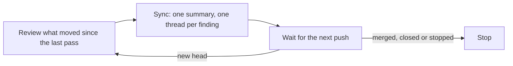

# thurview

**Your coding agent reviews an opened pull or merge request, on the forge,
and keeps that review current until it merges.**

The review is one summary comment, edited in place, and one inline thread per
finding. Every review leads with the architecture - whether the change puts
its logic where it belongs, and whether a fix removes a cause or patches a
symptom - before the bugs it causes. On every push it rechecks each of its
findings, resolves the fixed ones with evidence, and edits the summary.

[](https://github.com/Thurbeen/thurview/actions/workflows/ci.yml)
[](https://www.npmjs.com/package/thurview)
[](https://opensource.org/licenses/MIT)

## Install

One command installs the skill for Claude Code, Codex, Cursor, OpenCode or
any agent that reads the Agent Skills format, through the
[skills](https://github.com/vercel-labs/skills) CLI:

```sh
npx skills@latest add https://github.com/Thurbeen/thurview \
  --skill '*' --agent universal claude-code --global --yes
```

You need Node 22 or later and git, plus `gh` for GitHub or `glab` for
GitLab. Other routes - pinning a release, the command from npm, upgrading -
are in [docs/INSTALL.md](docs/INSTALL.md).

## Use it

Ask your agent `Use thurview-pr-review to review <URL>`, or run
`/thurview-pr-review <number or URL>`.



Each sync also sets a `thurview/review` commit status on the reviewed head,
`success` only at confidence 5 with nothing open, so a repository can
[require it before merge](skills/thurview-pr-review/references/forges.md#requiring-the-review).
The review never approves, merges, closes or pushes. A reader stops it with
the `thurview:stop` label or a comment starting `/thurview stop`.

## CLI

The skill drives these; you rarely type them.

| Command                                                   | Purpose                                                        |
| --------------------------------------------------------- | -------------------------------------------------------------- |
| `thurview pr-review status --change N`                    | Where the review stands: heads, open findings, other reviewers |
| `thurview pr-review sync --change N --file F [--dry-run]` | Post or edit the summary and the finding threads               |
| `thurview pr-review wait --change N`                      | Block until a push, merge, close or stop                       |
| `thurview pr-review stop\|start --change N`               | Stop or resume following the change request                    |
| `thurview setup skill\|status`                            | Link the bundled skill into your agents                        |
| `thurview update`                                         | Self-update from npm                                           |

thurview is an [AXI](https://axi.md): output is [TOON](https://toonformat.dev),
errors carry a `help` to act on, and `thurview <command> --help` lists every
flag.

## Configuration

Everything lives under `~/.thurview` (or `$THURVIEW_HOME`); nothing about a
review is stored there - its state is in hidden markers on the forge.

- **Agent guidance**: `~/.thurview/THURVIEW.md` for you, `THURVIEW.md` at a
  repository root for that repository.
- **Trusted review bots**: `~/.thurview/reviewers.json`, as
  `{"bots": ["greptile-apps[bot]"]}`, whose threads the review answers.

## Documentation

- [The skill](skills/thurview-pr-review/SKILL.md): the whole review flow.
- [Forges](skills/thurview-pr-review/references/forges.md): what GitHub and
  GitLab each do, and how to require the review.
- [docs/INSTALL.md](docs/INSTALL.md): other install routes and upgrades.

## Contributing

[CONTRIBUTING.md](CONTRIBUTING.md) covers the hooks, the checks, commits and releases.

```sh
pnpm install && pnpm build && pnpm check
```

## License

MIT, see [LICENSE](LICENSE).
