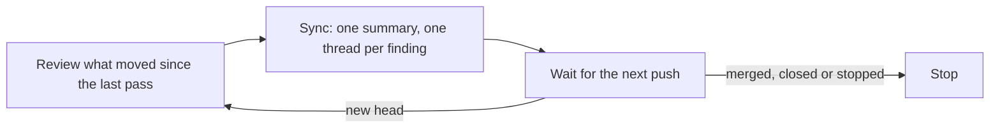

# thurview

**Your coding agent reviews an opened pull or merge request, on the forge,
and keeps that review current until it merges.**

The review is one summary comment, edited in place, and one inline thread per
finding. Every review leads with the architecture - whether the change puts
its logic where it belongs, and whether a fix removes a cause or patches a
symptom - before the bugs it causes. On every push it rechecks each of its
findings, resolves the fixed ones with evidence, and edits the summary.

CI is independent of the review. thurview never reruns the tests, linters,
type checkers or builds CI runs, never reads CI results, and never waits for
them. It spends the review on what CI and static analysis cannot check:
architecture (boundaries, coupling, contracts, data ownership), security
(authn and authz, secrets, injection, trust boundaries, least privilege,
supply chain), correctness of intent, failure modes, operability,
maintainability and simplicity.

Security is reviewed from a threat model: the trust boundaries the change
touches, and what an outsider can do at each. And when a finding names a
concern that no test holds in place, its thread carries a **guard**: a sketch
of the test that would, in the repository's own language and tooling - an
architecture test, a property test, a contract test, a fuzz target, a static
rule, a policy. thurview recommends and sketches these; it never runs them.

[](https://github.com/Thurbeen/thurview/actions/workflows/ci.yml)
[](https://www.npmjs.com/package/thurview)
[](https://opensource.org/licenses/MIT)

## Install

One command installs the skill for Claude Code, Codex, Cursor, OpenCode or
any agent that reads the Agent Skills format, through the
[skills](https://github.com/vercel-labs/skills) CLI:

```sh
npx skills@latest add https://github.com/Thurbeen/thurview \
  --skill '*' --agent universal claude-code --global --yes
```

You need Node 22 or later and git, plus `gh` for GitHub or `glab` for
GitLab. Other routes - pinning a release, the command from npm, upgrading -
are in [docs/INSTALL.md](docs/INSTALL.md).

## Use it

Ask your agent `Use thurview-pr-review to review <URL>`, or run
`/thurview-pr-review <number or URL>`.



Each sync also sets a `thurview/review` commit status on the reviewed head,
`success` at confidence 5 with nothing open, or at `--approve-at <n>` or more
with no blocking finding open, so a repository can
[require it before merge](skills/thurview-pr-review/references/forges.md#requiring-the-review).
The review never merges, closes or pushes, and approves only when the requester
passes `--approve-at <n>` and that status passes: 5 by default, 4 to approve a
4/5 whose open findings are non-blocking.
Approval rests on the review's own findings and confidence alone; CI's
result neither blocks it nor grants it. A reader stops it with
the `thurview:stop` label or a comment starting `/thurview stop`.

## CLI

The skill drives these; you rarely type them.

| Command                                                   | Purpose                                                        |
| --------------------------------------------------------- | -------------------------------------------------------------- |
| `thurview pr-review status --change N`                    | Where the review stands: heads, open findings, other reviewers |
| `thurview pr-review sync --change N --file F [--dry-run]` | Post or edit the summary and the finding threads               |
| `... sync ... --approve-at S`                             | Also approve the reviewed head when its status passes          |
| `thurview pr-review wait --change N`                      | Block until a push, merge, close or stop                       |
| `thurview pr-review stop\|start --change N`               | Stop or resume following the change request                    |
| `thurview setup skill\|status`                            | Link the bundled skill into your agents                        |
| `thurview update`                                         | Self-update from npm                                           |

thurview is an [AXI](https://axi.md): output is [TOON](https://toonformat.dev),
errors carry a `help` to act on, and `thurview <command> --help` lists every
flag.

## Configuration

Everything lives under `~/.thurview` (or `$THURVIEW_HOME`); nothing about a
review is stored there - its state is in hidden markers on the forge.

- **Agent guidance**: `~/.thurview/THURVIEW.md` for you, `THURVIEW.md` at a
  repository root for that repository.
- **Trusted review bots**: `~/.thurview/reviewers.json`, as
  `{"bots": ["greptile-apps[bot]"]}`, whose threads the review answers.
- **Identity**: a review runs as the account `gh` or `glab` is logged in as.
  thurview never looks for App tokens or keys and never falls back to an App.
  A caller that runs it under a GitHub App installation token sets that token
  and `THURVIEW_LOGIN`, the App's `<app-slug>[bot]`, in the environment
  itself, since GitHub refuses the token `GET /user`. Approval needs
  `--approve-at` either way.

## Documentation

- [The skill](skills/thurview-pr-review/SKILL.md): the whole review flow.
- The lenses:
  [architecture](skills/thurview-pr-review/references/architecture.md),
  [security](skills/thurview-pr-review/references/security.md) and
  [guards](skills/thurview-pr-review/references/testing.md), the tests a
  review recommends.
- [Forges](skills/thurview-pr-review/references/forges.md): what GitHub and
  GitLab each do, and how to require the review.
- [docs/INSTALL.md](docs/INSTALL.md): other install routes and upgrades.

## Contributing

[CONTRIBUTING.md](CONTRIBUTING.md) covers the hooks, the checks, commits and releases.

```sh
pnpm install && pnpm build && pnpm check
```

## License

MIT, see [LICENSE](LICENSE).
