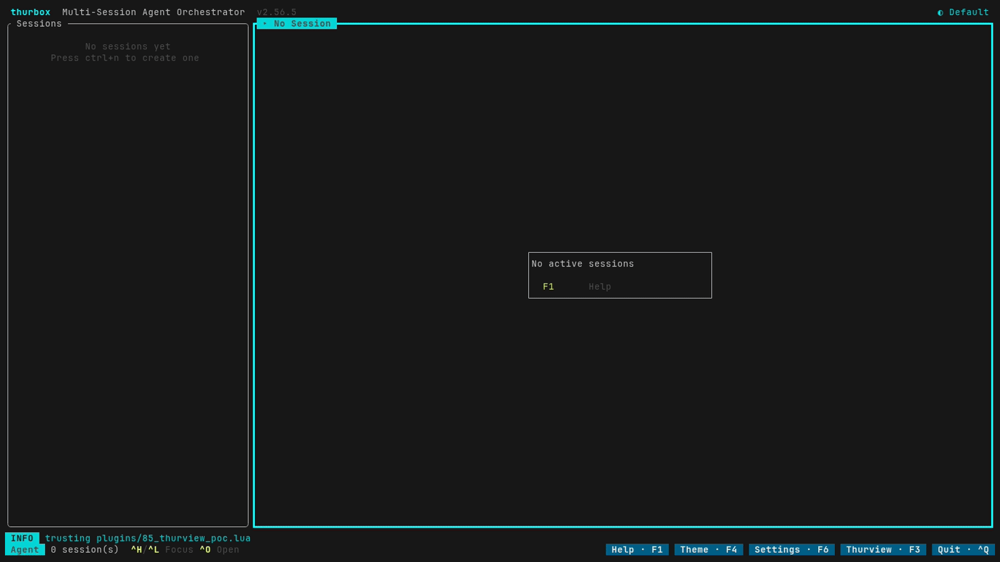
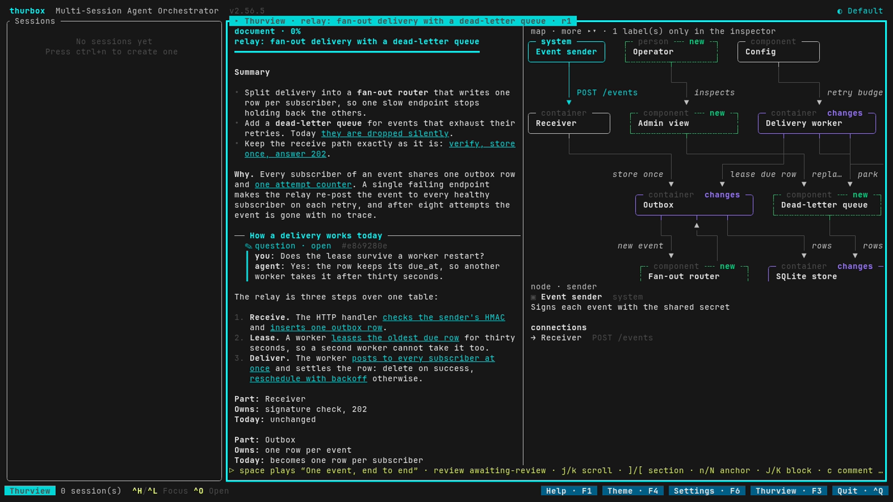
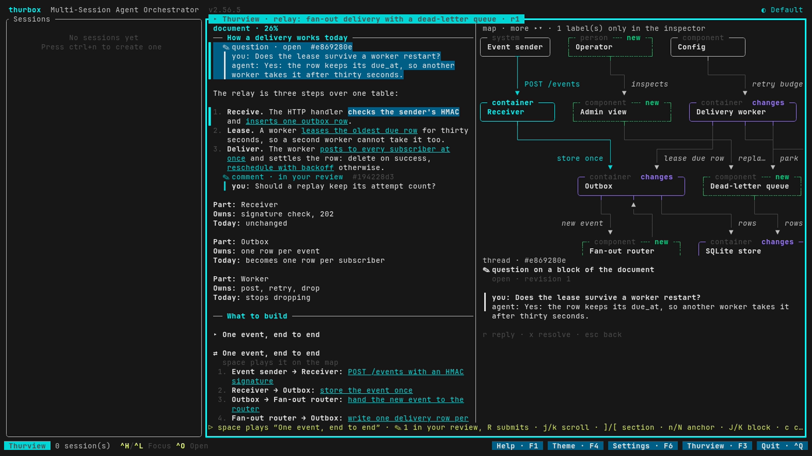
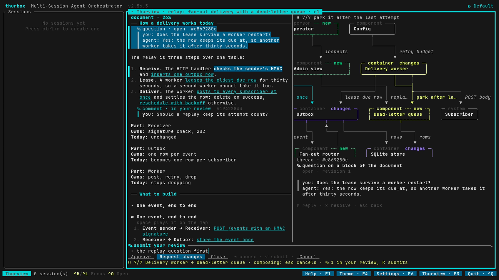
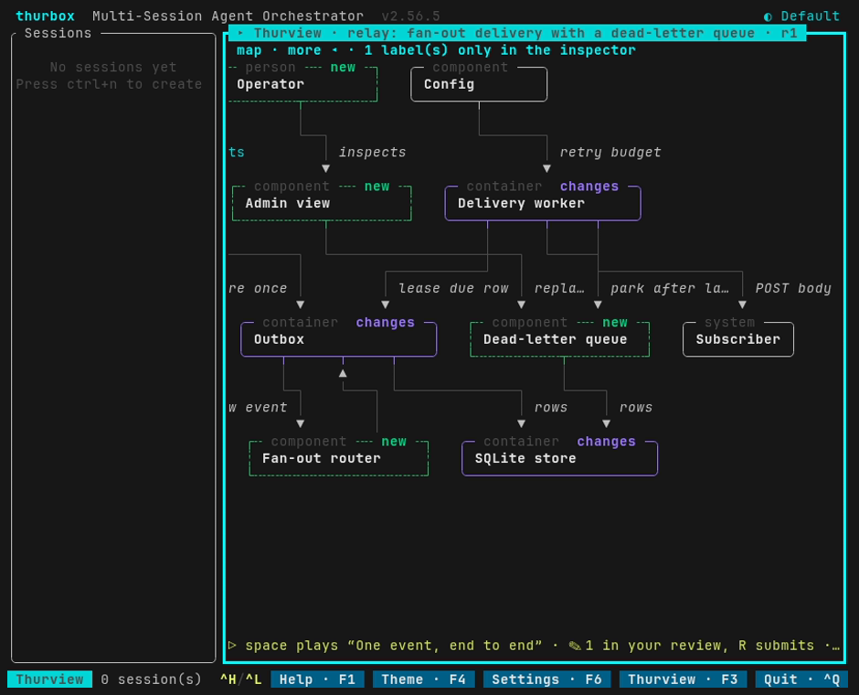

# Thurview in a terminal: proof of concept

A thurview architecture document read and reviewed inside a terminal by a
thurbox pane. You get:

- the prose and the software map, drawn as boxes and labelled connections;
- code anchors at the pinned commit;
- a flow animation over the map;
- comments, questions, replies and the review decision, as in the browser.

It works by keyboard and by mouse, and an agent can drive it with one CLI call
per step. Everything is text and box-drawing characters, with no browser or
WebView.

This is a proof of concept, not an integration: nothing here is installed by
thurview, and it reads one published revision.



| Wide pane: document, map, inspector          | A comment in your review, and the answer    |
| -------------------------------------------- | ------------------------------------------- |
|  |       |
| **Submitting the review**                    | **Narrow pane: the map on its own, panned** |
|         |    |

Every image is a capture of the real thurbox 2.56.5 TUI recorded with VHS
(`demo.tape`, `narrow.tape`), not a mock-up.

## Try it

From a checkout of this repository, with `pnpm install` done and `git`, `tmux`,
`thurbox` and `thurbox-cli` on `PATH`:

```sh
examples/terminal-poc/demo.sh          # build, install into a sandbox, launch
examples/terminal-poc/demo.sh clean    # stop the sandbox and delete it
```

`demo.sh` never touches your own thurbox. It runs one under `~/.cache/tvpoc`
with its own `HOME`, `THURBOX_CONFIG_DIR`, `THURBOX_DATA_DIR`, session socket and
`TMUX_TMPDIR`. Then it:

1. commits the fixture's code to a scratch repository;
2. publishes the fixture design there with thurview itself, into a
   `THURVIEW_HOME` of its own;
3. projects the sealed revision, installs the pane and starts that thurbox.

**Commenting needs one grant, and only you can give it.** In the sandboxed
thurbox press `F6`, then `]` for the Interface tab. Select
`plugins/85_thurview_poc.lua` and press `t`. The pane uses `run` for nothing
but its writes. Without the grant it still reads, draws and navigates, and says
why it cannot write.

To view one of your own published documents instead, point `demo.sh` at a
revision directory. Comments then go to that review's store, the same files the
browser and the CLI write:

```sh
THURVIEW_POC_REVISION=~/.thurview/reviews/<id>/revisions/<n> examples/terminal-poc/demo.sh
```

### Keys and mouse

| Key                                    | Mouse                                       | Does                                                         |
| -------------------------------------- | ------------------------------------------- | ------------------------------------------------------------ |
| `F3`                                   |                                             | open the pane, or go back where you were                     |
| `Tab`                                  | click a region's caption                    | document → map → inspector (one at a time below 100 columns) |
| `j` `k` `PgDn` `g` `G`                 | wheel over the document                     | scroll                                                       |
| `]` `[`                                |                                             | next / previous section                                      |
| `n` `N`, `Enter`                       | click an underlined anchor                  | select a code anchor and read its code; the map follows      |
| `J` `K` (document)                     | click a block                               | select the block a comment goes on                           |
| `j` `k` (map), `←` `→`                 | click a part, wheel over map                | select a part; pan                                           |
| `c`                                    | double-click a block or part                | comment on the selected block or part                        |
| `C`                                    |                                             | comment on the whole document                                |
| in the composer: `Tab`, `Enter`, `Esc` | **Add to review**, **Ask now**, **Cancel**  | choose held-for-review or ask-now, send, cancel              |
| `t` `T`                                | click a thread                              | next / previous thread                                       |
| `r`, `x`                               |                                             | reply to the thread; resolve or reopen it                    |
| `R`, then `Tab` `Enter`                | **Approve**, **Request changes**, **Close** | submit the review with a decision                            |
| `Space`, `.` `,` `s`                   | click the playing caption                   | play or pause the flow; step; next sequence                  |

`F1` lists the keys, and `Ctrl+P` → "thurview" opens the pane too.

## Reviewing, as the browser does

The pane writes the way the reader does in the browser, through the same code.
`bridge.mjs` calls thurview's own `src/threads.ts`: `createThread`,
`replyThread`, `setThreadStatus` and `submitReview`. Those are the functions its
HTTP API and its CLI call, so there is no second writer and no second store.
Those functions rewrite `threads.json` whole with no lock, so bridges take turns
on a lock directory under `$THURVIEW_HOME/terminal-poc-locks`. The lock covers
bridges only: a write from the server or the CLI at the same moment is not
held back by it.

- **Add to review** holds a comment until you submit, as the browser does. The
  agent sees it listed but is not asked to answer it.
- **Ask now** sends a question the agent's `thurview wait` reports at once.
- **Submit** records approve, request-changes or close, releases every held
  comment, and moves the review's status, exactly as the browser's submit does.
- A thread shows as a card under the block or part it is on, with who said
  what. The agent's replies appear on the next listing, at most 30 s later or
  straight after your next write.

What is not here yet: comments on diff lines (this pane draws designs, which
have no diff), live presence, and the browser's push updates. The pane lists on
a timer instead of listening to the server's event stream.

## For agents: reproduce it cheaply

Three ways in, cheapest first. None needs a browser or a screenshot.

1. **The view alone**, with no thurbox at all. This runs in 9 ms and returns a
   frame of about 6 KB of plain text:

   ```sh
   printf 'size 120 40\nclicktext Outbox\nkey c\ntype is one table enough?\nkey enter\nprint 0\n' \
     | lua5.4 examples/terminal-poc/drive.lua <interface dir>
   ```

   `drive.lua` takes `key`, `type`, `click`, `clicktext`, `wheel`, `act` and
   `threads`, and prints frames as text (`print`) or JSON (`render`, which also
   lists the writes the view asked for). The tests drive the view this way.

2. **A running sandboxed thurbox**, driven by name with no keystrokes. Every
   key and click has a typed action:

   ```sh
   thurbox-cli ui action thurview.comment --arg target=block:<id> --arg "body=…" --arg mode=ask
   thurbox-cli ui action thurview.submit  --arg decision=request-changes --arg "body=…"
   thurbox-cli ui action thurview.select  --arg target=node:relay.outbox
   thurbox-cli ui state --json   # plugin_state["plugins/85_thurview_poc.lua"]
   ```

   `thurview.reply` and `thurview.resolve` take a `thread=<id>`. `ui state`
   reports the pane's focus, selection, flow step, thread counts, review status
   and whether it can write. Block ids are the compiled ids in the revision's
   `document.json`.

3. **The tests**: `pnpm exec vitest run test/terminal-poc.test.ts`, about 10 s.
   They publish the fixture with the real CLI and drive the bridge and the view.
   Where `thurbox` and `tmux` exist, they also install the pane into an isolated
   thurbox and drive it: keys, the grant in thurbox's own settings, a comment by
   `ui action` and one typed in the composer, and mouse clicks and wheel ticks
   sent by a real tmux client on a pty.

## How it works

```text
 thurview publish        project.ts                 thurbox pane
 ────────────────        ──────────                 ────────────
 review.md ┐             document.json ─┐           plugins/85_thurview_poc.lua
 data.yaml ├─► sealed ─► map.json ──────┼─► model ─► thurview_poc/view.lua ──► cells
 map.yaml  ┘   revision  meta.json ─────┘   .lua     thurview_poc/diagram.lua
                  ▲                                   │ comment, reply, resolve, submit
                  │        bridge.mjs                 ▼
                  └── threads.json ◄── src/threads.ts ◄── run (granted), one process per write
```

- **One authority.** `project.ts` reads the sealed revision and nothing else,
  and `bridge.mjs` writes through thurview's threads module. HTML prose becomes
  styled runs, highlighted code becomes role tokens, sequence actors become map
  nodes. Each block keeps the compiled block id a comment targets.
- **The view is host-independent.** `view.lua`, `diagram.lua` and `threads.lua`
  read no thurbox global. They take a size, a clock, keys, clicks, wheel ticks
  and the bridge's answers, and return rows of spans plus the writes to make.
  That is why `drive.lua` and the tests run them in plain Lua 5.4, the
  interpreter thurbox embeds. The pane file adapts the result to the host: the
  rect, the clock, the theme roles, the `run` calls, `ui_state` and the typed
  actions.
- **The diagram** is a layered layout, the way dot does it. Cycles are broken,
  parts go on longest-path layers, placeholders are threaded through the layers
  a long edge skips, and each layer is ordered by barycentre. Edges route
  through per-channel lanes so two runs never share a cell lengthwise. Labels go
  in free cells beside their arrowheads. A label with no room is counted on the
  caption and listed in the inspector.
- **The animation** plays a sequence block over the map, one message per 1.2 s.
  It stops after the last message, pauses on `Space`, reads the clock only while
  playing, and costs nothing while the pane is hidden.
- **The bridge's answer is a line format**, hex for free text. The plugin
  sandbox has no JSON decoder and no `load`, and hex needs no shell quoting
  either. Every write answers with the review's whole thread state.

## What carries over, and what needs a design of its own

| Carries over to a terminal                                                    | Needs a design of its own                                              |
| ----------------------------------------------------------------------------- | ---------------------------------------------------------------------- |
| Title, sections, prose with emphasis, lists, tables (stacked when narrow)     | Inline images, rich HTML, and pixel-exact diagrams                     |
| Code anchors: file, lines, pinned commit, highlighted code                    | A file explorer and full diffs, with comments on diff lines            |
| The software map: parts, kinds, proposal marks, labelled connections          | Nested containers drawn as boundaries, base-versus-proposal toggling   |
| Sequence blocks, played over the map; flow blocks as text                     | Callstack and database components (named, "drawn in the browser only") |
| Comments on blocks, parts and the document; ask now; replies; resolve; submit | Live presence, and push updates from the server's event stream         |
| Keyboard, mouse (click, double-click, wheel), and typed actions for agents    | Drag to select text into a comment's quote                             |

## Feasibility, measured

Measured on Linux with thurbox 2.56.5, in a 160 × 45 terminal, against the
fixture here and against a real design with 21 parts, 21 connections and 17
sections.

- **It fits the host's documented API.** The pane uses four node kinds,
  `require` inside the interface directory, theme roles, declared keys and
  actions, `on_click`, `on_scroll`, `ui_state`, and `run` with
  `machine = "local"`. `thurbox-cli plugin check` loads it, lua-language-server
  finds no problem against `thurbox.d.lua`, and selene finds none against
  thurbox's sandbox standard library. `check` raises one warning, that on_click
  handles gestures not advertised as catalog actions. 2.56.5 does not document
  the rule behind it; every click here has a typed action and a key.
- **Raster graphics are not available.** A pane paints ratatui cells, and a
  program surface is emulated by the `vt100` crate, which has no sixel or kitty
  graphics. Box drawing at one cell per glyph is the ceiling.

**Cost.** A frame takes about 1.5 ms in plain Lua 5.4 at 158 × 42. The first one
takes 3 ms on the fixture and 17 ms on the larger design, because it wraps the
document and lays out the map, once per width. A write or a listing is one Node
process of about 53 ms. Listings happen every 30 s, and only while the pane is
drawn. CPU of the whole TUI process and its children, from `/proc`, over
6–8 s windows, with the pane granted and listing:

| State                     | CPU of one core |
| ------------------------- | --------------- |
| Pane closed (baseline)    | 0.4%            |
| Pane open, idle           | 1.1–1.4%        |
| Flow playing              | 2.5–3.2%        |
| Flow playing, pane hidden | 0.7%            |

### Host gaps, exactly

1. **A pane cannot ask for the animation clock.** The host advances its shared
   tick only while a session is working or a command is in flight, so a `pure`
   pane's animation freezes on an idle screen. This pane is not `pure`. It
   caches its own tree while idle, which is most of the idle cost over baseline. A
   declaration such as "animating until I say otherwise" would let it be pure.
2. **Writing needs the `run` grant, given in the settings UI.** No action or
   command grants it, which is right for your own interface. The tests grant it
   by pressing the same keys you would.
3. **`run` needs a session unless asked for `machine = "local"`.** An idle
   thurbox with no session would otherwise fail every write with "no session to
   run it in".
4. **A run's answer is collected only while the pane is drawn.** The write
   itself happens either way: one sent just before hiding the pane lands in
   thurview.
5. **Asking for a run on every frame costs repaints, not processes.** With the
   listing asked on every render and a 30 s `ttl`, the bridge still ran once per
   window. The pane, though, rendered 231 times in about 15 s against 52, and
   idle CPU rose to 7.4%. So the pane asks for its listing on a schedule of its
   own, every 30 s from the render clock, and asks for each write once.
6. **Width is counted in code points.** That holds for box drawing and Latin
   text but not for CJK. The host's `text.width` is the fix, kept out so the
   view runs outside thurbox.

## Towards a thurbox-thurview plugin

1. **thurview projects and writes, the plugin draws.** Move `project.ts` and
   `bridge.mjs` into the CLI, say `thurview terminal-model` and a reader-side
   `thurview comment` / `submit`. The pane would then call one installed
   command, and the store stays the only authority.
2. **A plugin repository** installed with `thurbox-cli plugin install git+<url>`,
   holding these four Lua files.
3. **Listen rather than poll.** The browser's server pushes thread changes, and
   a `run` that follows `thurview wait` could do the same for the pane.
4. **The tests come along.** `test/terminal-poc.test.ts` already drives the view
   in Lua 5.4, the bridge against thurview's CLI, and the installed pane in an
   isolated thurbox by key, mouse and typed action.

## Files

| File                             | What it is                                                              |
| -------------------------------- | ----------------------------------------------------------------------- |
| `project.ts`                     | sealed revision → `model.lua`                                           |
| `bridge.mjs`                     | comments, replies, resolve and submit through thurview's threads module |
| `drive.lua`                      | the view without thurbox: keys, clicks, actions in, frames out          |
| `ui/plugins/85_thurview_poc.lua` | the thurbox adapter: keys, mouse, clock, theme, `run`, actions, state   |
| `ui/thurview_poc/view.lua`       | layout, navigation, inspector, threads, composer, animation             |
| `ui/thurview_poc/diagram.lua`    | the map as a grid of cells                                              |
| `ui/thurview_poc/threads.lua`    | the bridge's answer, read back                                          |
| `install.sh`                     | copies the pane and a model into an interface directory                 |
| `demo.sh`                        | the whole sandbox: build, publish, project, install, launch             |
| `demo.tape`, `narrow.tape`       | the VHS scripts that recorded `media/`                                  |
| `fixture/`                       | a sanitized design: a small webhook relay and its code                  |
