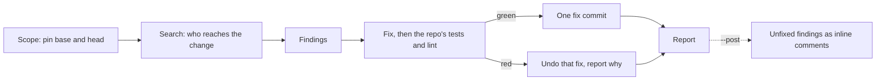

# thurview-fix

Review a change, fix what you are sure of, report the rest. The diff shows what
changed; a search of the code around it shows what depends on it, which is
where a change breaks code the diff never shows.



Run the CLI as `thurview`, or `npx -y thurview` when it is not on PATH. It
prints TOON, and exit code 2 is a usage error. If it answers `unknown flag` for
something below, run `thurview update` and retry once.

## Request

$ARGUMENTS

## Never

- Never push, force-push or post unless this request asks for it. `--post`
  asks to post comments; pushing the fix commit needs its own ask.
- Never rewrite the branch's history. Fixes are a new commit on top.
- Never report style. A finding is an architecture defect, a bug, a
  regression for a caller, a missing or broken test, or a security issue.
- Never commit a symptom patch: a special case at the failure site when the
  cause is in the design. Report the design defect instead.

## 1. Scope

Start from a clean tree (`git status --porcelain` prints nothing), otherwise
ask: the fixes get committed. Check out the head, then pin both commits:

| Request            | Check out                                      | Base                                  |
| ------------------ | ---------------------------------------------- | ------------------------------------- |
| empty              | the current branch                             | `git merge-base origin/HEAD HEAD`     |
| a branch           | `git switch <branch>`                          | `git merge-base origin/HEAD HEAD`     |
| `<base>..<head>`   | the branch at `<head>`                         | `git rev-parse <base>`                |
| a PR or MR ref/URL | `gh pr checkout <n>` or `glab mr checkout <n>` | `git merge-base origin/<target> HEAD` |

Head is `git rev-parse HEAD`, taken now. For a change request,
`thurview forge status --change <ref>` names `<target>` as
`change.baseBranch`; when `origin/HEAD` is unset, use the trunk branch by name.

Write both full shas down and use them, not `HEAD`, in every later command, so
your fix commit does not move what you are reviewing.

## 2. Search what the change reaches

List what changed, then find what the diff does not show, at the pins, with
the recipes in the `thurview` skill's Searching the code reference
(`thurview skill` prints its path):

```sh
git diff --stat <base> <head>                              # the files
git diff <base> <head>                                     # the change
git grep -n -E -e '\bname *\(' <head> --                   # who calls a changed symbol now
git grep -n -E -e '\bname *\(' <base> --                   # who called it before; a removed one's callers are only here
git grep -n -E -e '\bname\b' <head> -- '*test*' '*spec*'       # which tests name it
```

What to look for:

- **The architecture, first.** Read the `thurview` skill's Architecture
  reference (`references/architecture.md` beside its `SKILL.md`) and run its
  patch test on every fix the change makes: a special case at the failure
  site, a rule written a second time, an import against the grain, an
  interface bent to fit one caller. Run its searches at both pins: what the
  change introduced or deepened is its finding.
- **Callers the change left alone.** For every function, method, type or
  export whose signature or behaviour the diff changed, search its callers at
  head and drop the ones the diff itself touched. What is left is what the
  author may have forgotten: read each call site against the new behaviour.
  This is the finding a diff cannot give you.
- **Removed or renamed interfaces.** Search the old name at head: any hit is
  a caller the change broke.
- **Untested reach.** A changed symbol, or a caller of one, that no test names
  has nothing to catch a break there.
- **What a search misses.** A text search finds names, not meaning: a call
  through a variable, a re-export or a string-built name escapes it. "No
  callers" is only as true as the forms you searched; say which when a finding
  rests on it.

Then read every call site the searches name.

## 3. Findings

For each one, record:

- `file:line` at `<head>`, now, before a fix moves lines
- kind: `architecture` (the design lets this class of bug happen, per the
  reference), or the plain defect
- severity: `high` (wrong behaviour on a normal path, data loss, security, or
  a design defect the change introduces or deepens),
  `medium` (a likely bug, or a risky path no test reaches), `low` (real but
  narrow)
- why, in one line
- the search evidence when there is some: the search and the hit, e.g.
  `git grep -n -E -e '\bdiscount *\(' <head>` → `src/cart.js:5`, no test names
  it

Security means input crossing a trust boundary: a shell command, query or path
built from it, a secret reaching a log, an authorization check the change
skips.

A problem that is just as present at `<base>` is not this change's finding.
Leave it unfixed and list it after the report's table.

## 4. Fix

Find the repository's own test and lint commands - `CONTRIBUTING.md`,
`AGENTS.md`, the package manifest's scripts, a `Makefile`, the CI config - and
run them once before editing. What is already red at head is not yours: note
it, and judge each fix by not making it worse.

Fix the cause, not the symptom. Before editing, run the patch test on the
finding: when the bug exists because of a design property - two copies of a
fact, a rule in the wrong module, a type that admits a bad state - the fix is
the structural one (move the rule, derive from one source, narrow the type),
not a conditional where the failure showed up. Make the structural fix when it
stays inside this change's files and keeps every interface used outside the
repository; otherwise leave it unfixed and report its cause, target and next
step. A conditional is the fix only when the rule belongs at that spot.

For each finding whose fix is in proportion and whose right behaviour is unambiguous:

1. For a bug, first add or extend a test and run it: it must fail, for the
   reason the finding gives.
2. Edit, then run the tests and lint.
3. Green: keep it. Red: undo only that fix (`git restore <files>`, and delete
   files it created) and mark the finding unfixed, with the failure as why.

Leave a finding unfixed when it needs a decision the code cannot make, changes
an interface used outside this repository, no test can show it, or the only
fix within reach is a symptom patch.

Once every kept fix passes together, commit them as one. Follow the
repository's commit convention when it has one; otherwise:

```sh
git add <files>
git commit -m "fix: address review findings" -m "<one line per fix: file:line - why>"
```

## 5. Report

Architecture findings first, each with its cause, target and next step. Then
one table - severity, `file:line`, the finding, its search evidence, and the
fix commit or why it is unfixed - then the tests and lint after the commit, and
what the searches could not see. Do not push; offer to.

## 6. Post, with `--post` only

Only on a change request, only the unfixed findings, and before the fix commit
is pushed, so the lines still match the forge's head. Write `pass.json`:

```json
{
  "verdict": "comment",
  "body": "<what was fixed locally, what is left and why>",
  "comments": [{ "path": "src/cart.js", "line": 5, "body": "<the problem, then a suggestion>" }]
}
```

A comment must sit on a line the change request's diff touches, or the forge
refuses it; a finding on an untouched caller goes in `body`, with a link in the
`permalink` shape `forge status` prints. Keep each comment to a few lines, and
follow the user's own rules for text posted in their name when they keep any.
Check, then post:

```sh
thurview forge submit --change <ref> --file pass.json --dry-run
thurview forge submit --change <ref> --file pass.json
```

The verdict stays `comment`: approving is the maintainer's call. How GitHub and
GitLab differ is in [Forges](references/forges.md).
