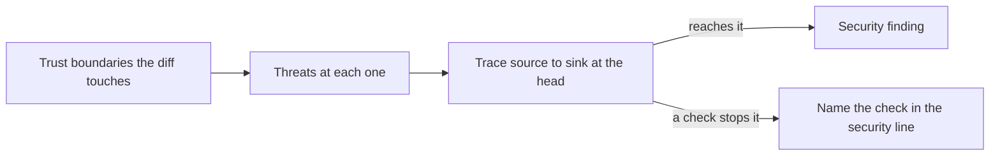

# Reviewing the security

A security review starts from a threat model, not from a list of bad
functions. A scanner finds the `eval`; only a reader finds the endpoint that
checks who you are and never checks what you may touch.

## 1. Find the boundaries the diff touches

A trust boundary is where data or control passes between parties that do not
trust each other equally. List the ones this change adds, moves or weakens:

- **Input**: a request, header, query, upload, webhook, queue message, file,
  environment variable, CLI argument, or the output of a model or a tool.
- **Identity**: a login, session, token, API key, service account, role check.
- **Storage and secrets**: a database, bucket, cache, log, config, key.
- **Outbound**: a URL the code fetches, a command it runs, a template it fills.
- **Build and deploy**: a dependency, a lockfile, a CI workflow, a container
  image, IaC, an install script.

No boundary touched is an answer: say so in the `security` line, with what
you checked, and stop here.

## 2. Ask the threat questions at each boundary

| Threat                 | Ask of the changed code                                                                |
| ---------------------- | -------------------------------------------------------------------------------------- |
| Spoofing               | Who does it believe the caller is, and what proves it? Is the proof checked here?      |
| Tampering              | What can the caller change that the code then trusts: an id, a path, a price, a flag?  |
| Repudiation            | Does a sensitive action leave a record of who did what, without secrets in it?         |
| Information disclosure | What does the response, error, log or cache reveal, and to whom?                       |
| Denial of service      | What grows with attacker input: a loop, a regex, an allocation, a fan-out, a retry?    |
| Elevation of privilege | Can a caller reach a capability, tenant or role it was not granted, directly or by id? |

## 3. Check the classes the boundary invites

Each row is something a diff shows and a trace confirms: follow the value
from where the outsider controls it to where it acts.

| Class           | In the diff                                                                                                 | Confirm with                                                                     |
| --------------- | ----------------------------------------------------------------------------------------------------------- | -------------------------------------------------------------------------------- |
| Authentication  | A new route, handler, job or consumer; a token compared, parsed or minted; a session changed.               | The guard that runs before it, and that every sibling route has the same one.    |
| Authorization   | An object fetched by an id from the request; a role or tenant read from input.                              | The ownership or tenant check between the lookup and the use, on every path.     |
| Secrets         | A key, token or password in code, config, a log line, an error, a URL or a test fixture.                    | Where the value comes from, where it is printed, and who can read that place.    |
| Injection       | Input concatenated into SQL, a shell command, a path, HTML, a template, a regex, a header or a prompt.      | The sink's own escaping or parameter API, and whether this call uses it.         |
| SSRF            | A URL, host or redirect target taken from input and fetched from inside the network.                        | An allowlist applied after parsing and after redirects, not a prefix match.      |
| Deserialization | Untrusted bytes handed to a format that builds objects or runs code: pickle, YAML load, native serializers. | The loader used, and a schema that validates before anything is constructed.     |
| Supply chain    | A new or bumped dependency, an unpinned action or image, a script run at install or in CI, a lockfile edit. | Who publishes it, what it runs, the pin (a full commit or digest), the lockfile. |
| Least privilege | A wider scope, role, permission, CORS origin, bucket policy, token lifetime, or a `*`.                      | What the code needs versus what it now holds; the narrowest grant that works.    |

## Writing the finding

A security finding carries, each pointing at `path:line` at the head:

- **The path**: who controls the value, the line where it enters, the line
  where it acts, and that nothing between them stops it.
- **The impact**: what the attacker gains, in one clause.
- **The fix**: the check, the parameter API, the allowlist, the narrower
  grant - at the boundary, not at the symptom.

It is `blocking` when a party the code does not trust reaches a capability,
a secret or another tenant's data. Traced in the code is enough; it does not
wait for an exploit. A hardening the change could add, with no path to
impact, is `non-blocking` or a risk bullet, never padding for the count.

When the class can recur - the next handler can forget the same check - the
finding carries a `security` or `fuzz` guard, per
[Recommending a guard](testing.md), so the fix outlives this review.

## Where the view goes

`security` in `pass.json`, one line: the boundary the change touches and
what holds it, or that it touches none and how you know. Never read the
author's access or a signature as the change being safe.
