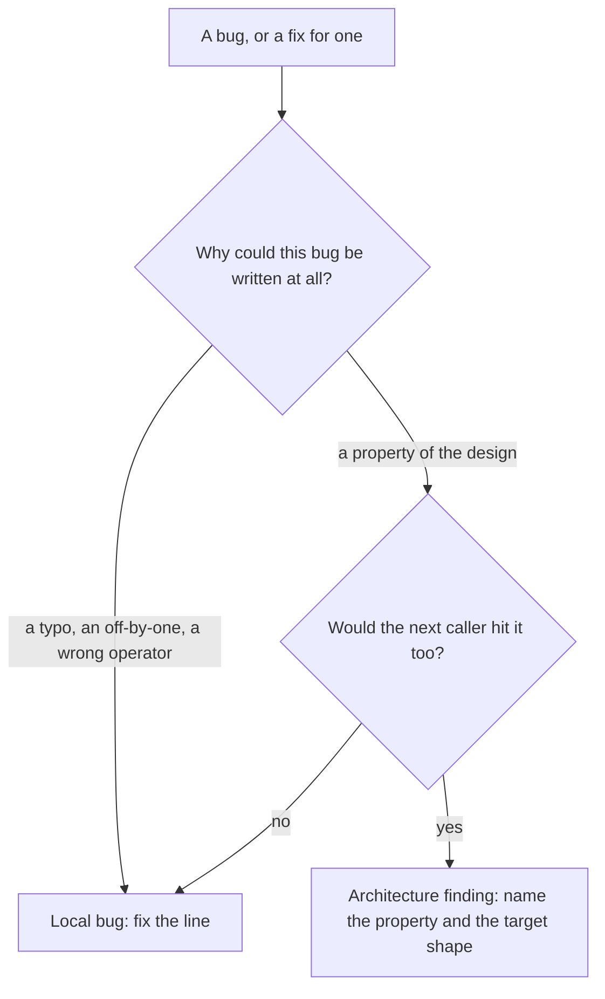

# Reviewing the architecture

Architecture is the first thing a review looks at and the last thing it gives
up on. A bug in a line costs one fix. A defect in the design costs a fix per
caller, forever, and each of those fixes is a small `if` that makes the next
one harder to see. A review that catches the bug and misses the design has
done the cheap half of the job.

So every review takes a view on the architecture, and answers two questions
before it hunts for bugs:

1. **Does the change put its logic in the right place?** The module that owns
   the data or the rule, behind the seam meant for it, with dependencies
   running the way the rest of the system runs them.
2. **Does it fix the cause, or patch a symptom?** A fix that adds a special
   case where the failure showed up, instead of removing what let the failure
   happen, is a symptom patch.

A finding that answers either one with "no" is an `architecture` finding. It
outranks a bug finding in the same code: fixing the design usually removes the
bug, and fixing the bug alone usually hides the design.

## The patch test

Run it on every fix the change makes, and on every bug you find yourself.

"A property of the design" is one of these: two places hold the same fact; a
type allows a state the code then has to check for; a rule lives in its callers
instead of its owner; a module reaches past an interface into an
implementation. A conditional is the right fix only when the rule genuinely
belongs at that spot. When it does not, the conditional is the symptom patch,
and the right fix removes the class of bug: make the invalid state
unrepresentable, move the rule to its owner, derive both copies from one
source, put the variation behind the interface that already exists.

## What a defect looks like

Each row is something a diff shows and a search confirms. The search is what
turns a suspicion into a finding the reader can check: run it at `<head>`, and
at `<base>` to tell what the change introduced from what it inherited.

| Defect                     | In the diff                                                                                                 | Confirm with                                                                                  |
| -------------------------- | ----------------------------------------------------------------------------------------------------------- | --------------------------------------------------------------------------------------------- |
| Symptom patch              | A new branch on one input, kind, caller or flag, or a `catch` that swallows one error, at the failure site. | The same discriminant elsewhere: `git grep -n -E -e "kind *=+ *['\"]foo" <head> --`           |
| Scattered switch           | Another case added to a `switch`/`if` chain on a type tag that other modules also switch on.                | Every place that tests the tag: `git grep -n -E -e '\.kind *=+' <head> --`                    |
| Misplaced responsibility   | A rule computed in a layer that does not own it: a handler doing storage, a view doing business logic.      | Where else the rule is computed; who owns the data it reads.                                  |
| Dependency against grain   | A lower layer importing a higher one, core importing an adapter, a new import cycle.                        | The importers recipe in both directions between the two modules.                              |
| Duplicated source of truth | A list, constant, schema or validation rule written a second time.                                          | The literal or key at head: `git grep -n -F -e '<literal>' <head> --`                         |
| Interface bent to a caller | A parameter, option or flag added to a shared function that one caller passes.                              | Callers of the function, and which of them pass it.                                           |
| Bypassed seam              | A caller reaching into another module's internals, or around the interface it already has.                  | Other callers of the same internals; the interface they were meant to use.                    |
| Hidden coupling            | Module-level mutable state, a singleton, an init order the change starts to depend on.                      | Every reader and writer of that state.                                                        |

A text search finds names, not meaning, so the rules in
[Searching the code](searching.md) hold here too: open each hit, and name the
search beside the claim it supports.

## Writing the finding

An architecture finding is guidance toward a better shape, not a complaint.
It carries three things, anchored:

- **The cause**: the design property, in one line, with the evidence - the
  search and its hits, or the two anchors that hold the same fact.
- **The target**: where the logic should live, which way the dependency should
  run, which single source the copies should derive from. Name the module,
  type or interface; "refactor this" is not a target.
- **The step**: the smallest change that moves toward the target, and whether
  it belongs in this change or a follow-up. A target nobody can take a step
  toward is an opinion.

Example: _The `retries === 0` guard patches one caller; `upload()` and
`sync()` each decide retry policy (`git grep -n -e 'retries' <head>` → 4 sites
in 3 files). Target: one `RetryPolicy` passed in by the caller. Step: move the
two existing checks into it here; the other callers can follow._

## Proportion

- **Severity follows what the change did.** It is blocking when the change
  introduces the defect or deepens it: a new cycle, a second source of truth,
  another case on a switch that is already scattered, a special case where the
  owner should change. A defect the change sits next to but does not make worse
  is the base's, not this change's: name it as context, not as a finding.
- **The fix asked for scales with the change.** A one-line fix that deepens a
  design problem gets a finding with a small step, not a demand for a rewrite.
  Say when the right move is a follow-up, and say what it is.
- **Evidence beats taste.** A preferred pattern, a naming style or "I would
  have split this differently" is not a defect. A defect has a cost you can
  show: a second place that must change in step, a caller that will hit the
  same bug, a dependency the rest of the system does not take.
- **No defect is an answer; no view is not.** When the change puts its logic
  where it belongs and fixes causes, say so, and how you know. That line is
  what makes the view worth reading on the review where there is a defect.

## Where the view goes

Every review states it, and the tools refuse one that does not:

- a review document: `architecture` in `data.yaml`, a `view` and one entry
  per defect - see [Components](components.md#architecture)
- a change request's summary: `architecture` in `pass.json`, one line, read
  right under the reason
- a fix pass: architecture findings first in the report
